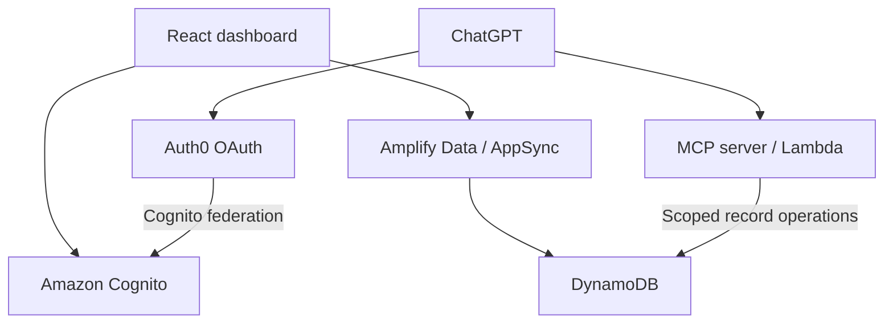

# Blix

**A personal health dashboard with a conversational interface through MCP.**

Blix brings food logs, nutrition summaries, weight trends and blood-pressure
readings into one account-based dashboard. Its Model Context Protocol (MCP)
server lets ChatGPT work with food, vital-sign and daily-target records through
OAuth-authorized tools.

Built with **React, TypeScript, AWS Amplify Gen 2, Cognito, AppSync, DynamoDB,
Lambda and Auth0**.

[Explore the backlog](https://github.com/users/betolix/projects/2)
· [Report an issue](https://github.com/betolix/blix-health-tracker/issues)
· [Review changes](https://github.com/betolix/blix-health-tracker/pulls)

## What you can do

- **Track nutrition:** log foods with calories, protein, carbohydrates, fat and
  fiber; identify values as measured, label-derived or estimated.
- **Review each day:** browse food logs and compare daily intake with the
  dashboard's nutrition reference values.
- **Follow vital signs:** record weight and blood pressure, inspect recent
  readings and view weight trends.
- **Set a personal weight goal:** save and edit a goal independently of daily
  nutrition targets. The card, remaining-weight calculation and chart use the
  saved goal. Accounts without a goal show an unset state.
- **Use English or Spanish:** switch dashboard and sign-in language immediately.
- **Choose light or dark mode:** use a responsive layout on desktop and mobile.
- **Connect ChatGPT:** read, create, update and delete supported records through
  MCP tools, subject to the access token's permissions and record ownership.

Health records and weight goals are stored in AWS. Language and theme preferences
are stored in the current browser; they are not synced between devices.

## Architecture

The dashboard and MCP server share the health-record data store, with separate
access paths:



- **Dashboard:** Amplify Auth handles sign-in. The generated Amplify Data client
  calls AppSync using user-pool authorization and owner-based model rules.
- **MCP:** Auth0 issues access tokens for the configured API resource. The Lambda
  handler verifies tokens and operation-specific scopes, resolves the federated
  Cognito identity, and applies ownership checks to DynamoDB operations.
- **Hosting:** Amplify Hosting builds the backend and serves the Vite frontend.

The deployed MCP entry point is
[`identity-probe-handler.ts`](amplify/functions/blix-mcp/identity-probe-handler.ts),
as configured in the function's [`resource.ts`](amplify/functions/blix-mcp/resource.ts).
Its historical name reflects the initial identity-probe work; it now also wires
in the food, vital-sign and daily-target handlers.

## Run locally

### Prerequisites

- Node.js **22.12 or newer** and npm.
- Access to an existing Blix Amplify environment and an AWS profile authorized to
  retrieve its configuration.
- The generated `amplify_outputs.json` in the repository root. Both development
  and production builds import this file; it is intentionally excluded from Git.

### Setup

```bash
git clone https://github.com/betolix/blix-health-tracker.git
cd blix-health-tracker
npm ci
```

Retrieve the configuration for your Amplify app and branch, replacing the
placeholder values:

```bash
npx ampx generate outputs \
  --app-id YOUR_AMPLIFY_APP_ID \
  --branch main \
  --profile YOUR_AWS_PROFILE
```

Then start the dashboard:

```bash
npm run dev
```

Open the local URL printed by Vite and sign in with an account in that
environment. Local development uses that environment's backend and records.

| Command | Purpose |
| --- | --- |
| `npm run dev` | Start the Vite development server. |
| `npm run build` | Type-check and create the production bundle in `dist/`. |
| `npm run preview` | Preview the built frontend locally. |

For a separate AWS environment, review the Cognito domain and OAuth callback
configuration in [`amplify/backend.ts`](amplify/backend.ts), plus the issuer,
resource and OAuth client settings in
[`auth0-probe.ts`](amplify/functions/blix-mcp/auth0-probe.ts), before provisioning.
These currently contain deployment-specific values.

## Data model

| Model | Purpose | Ownership |
| --- | --- | --- |
| `FoodEntry` | Dated food entries, nutrients, source and notes. | Owner-authorized records. |
| `Vital` | Timestamped weight and/or blood-pressure readings. | Owner-authorized records. |
| `DailyTarget` | Dated nutrition targets, with an optional legacy weight-target field. | Owner-authorized records. |
| `WeightGoal` | One persistent personal weight goal, independent of daily targets. | Cognito `sub` is both the `userId` primary key and authorized owner. |
| `OwnershipProbe` | Synthetic records used to exercise ownership isolation. | Owner-authorized test records. |

The definitions live in [`amplify/data/resource.ts`](amplify/data/resource.ts).

The dashboard's nutrition reference values are currently configured in
[`src/main.tsx`](src/main.tsx); the dashboard does not load them from `DailyTarget`.
The personal weight goal uses `WeightGoal`, not `DailyTarget.targetWeightKg`.
Existing daily-target values are not automatically migrated to personal goals.

## MCP integration

Connect an OAuth-capable MCP client to the deployment's **`/mcp` endpoint**.
The protected resource and Auth0 settings must match the server configuration;
see [`auth0-probe.ts`](amplify/functions/blix-mcp/auth0-probe.ts) for those values.
The issuer's `/.well-known/openid-configuration` publishes its discovery metadata;
it is not a client-registration endpoint.

The current token verifier checks the issuer, audience, signing algorithm,
timestamps, subject and authorized OAuth client. The configured client is
ChatGPT's client-metadata identifier; other OAuth clients require deliberate
configuration changes.

| Record type | Tools | Required scopes |
| --- | --- | --- |
| Food | `read_food_entries`, `create_food_entry`, `update_food_entry`, `delete_food_entry` | `food:read`, `food:create`, `food:update`, `food:delete`, respectively. |
| Vitals | `read_vitals`, `create_vital`, `update_vital`, `delete_vital` | `vitals:read`, `vitals:create`, `vitals:update`, `vitals:delete`, respectively. |
| Daily targets | `read_daily_targets`, `create_daily_target`, `update_daily_target`, `delete_daily_target` | `targets:read`, `targets:create`, `targets:update`, `targets:delete`, respectively. |

There is no personal-weight-goal MCP tool yet. Identity, ownership and synthetic
food probes are development utilities and are separate from normal health-record
operations. Tool-to-scope mappings live in
[`mcp-tool-scope.ts`](amplify/functions/blix-mcp/mcp-tool-scope.ts).

## Tests and validation

Run language and personal-goal regression tests:

```bash
node --import tsx --test tests/*.test.ts scripts/weight-goal*.test.ts
```

Run MCP unit, policy, contract and synthetic integration tests:

```bash
node --import tsx --test \
  amplify/functions/blix-mcp/*.test.ts \
  amplify/functions/blix-mcp/*.synthetic-test.ts
```

These tests use synthetic fixtures and injected dependencies. Passing them does
not establish that a deployed environment's OAuth configuration, IAM permissions
or account isolation are correct. After backend changes, verify sign-in,
authorization and persistence with separate test accounts against that deployment.

For frontend changes, check both languages and themes at mobile and desktop
widths. The personal-goal release checklist is in
[`WEIGHT_GOAL_REVIEW.md`](WEIGHT_GOAL_REVIEW.md).

## Deployment

[`amplify.yml`](amplify.yml) defines the hosting pipeline:

1. Install dependencies.
2. Deploy the backend with `ampx pipeline-deploy`, using Amplify's `AWS_BRANCH`
   and `AWS_APP_ID` values.
3. Run the frontend production build.
4. Publish `dist/`.

Deploy schema changes and generate matching Amplify outputs before validating
the frontend. Check the Amplify deployment result after merging; a merged PR
alone does not confirm a successful deployment.

## Repository guide

| Location | Contents |
| --- | --- |
| `src/` | Dashboard, charts, entry forms, personal-goal editor, styling and language support. |
| `amplify/auth/` | Cognito sign-in definition. |
| `amplify/data/` | Amplify models and authorization rules. |
| `amplify/functions/blix-mcp/` | MCP transport, OAuth verification, scope routing, record access and tests. |
| `amplify/backend.ts` | Resource wiring, table permissions, protections and Cognito federation configuration. |
| `scripts/` | Focused smoke checks and weight-goal regression tests. |
| `tests/` | Language regression tests. |

Work is tracked in [Blix Backlog](https://github.com/users/betolix/projects/2)
through **Backlog → Ready → In Progress → Review → Done**. Issues use type labels,
priority and a separate numeric **Orden** field for the chosen execution order.
